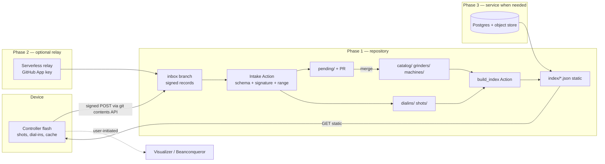

# Backend assessment

Dated 2026-10-12. Scope: where each *role* of data should live. Existing-system facts are from `source-code-findings.md`. Statements about GitHub limits are **Documented but untested** (GitHub's published limits as I know them; re-check before committing numbers into the design). Cost/volume numbers are **estimates**, not measurements.

## 1. Roles (from the brief) and what exists today

| # | Role | Existing in this project (`docs/COMMUNITY.md`) | Existing elsewhere |
| --- | --- | --- | --- |
| 1 | Public reference catalog | `coffees/`, `grinders/`, machines list in the library repo | Visualizer canonical search (API, data terms Unknown); Caliburr (Blocked) |
| 2 | User-private config + shot history | Controller flash (NVS/LittleFS); optional personal contributor repo | Beanconqueror (local device, JSON export); Grindstep (on-device); Visualizer (per-user account) |
| 3 | Submissions awaiting review | `inbox` branch + `pending/` + PR | Caliburr `*_edits` tables; Visualizer none |
| 4 | Approved shared records | `catalog/`, `grinders/` after PR merge | Caliburr `verified` flag after 5 confirmations |
| 5 | Raw telemetry | optional `shots/<yyyy>/<mm>/<id>.json` in contributor repos | Visualizer (files, per-user, rate-limited uploads); Beanconqueror `BrewFlow` files |
| 6 | Derived analytics / recommendations | `index/` built by Action (`build_index.py`), `index/models.json` etc. | Visualizer LLM `grind_suggestion` (admin only) |
| 7 | Search index / cache | `index/coffees.json` fetched whole; controller caches on LittleFS | Visualizer pg_trgm GIN indexes on `bean_brand/bean_type` |
| 8 | External sources | none yet | Visualizer canonical data ← Loffee Labs |

## 2. Candidate stores, evaluated

Legend: ● good, ◐ workable with caveats, ○ poor.

| Criterion | GitHub repo (files + PRs + Actions) | Existing app DB (Beanconqueror local / Visualizer account / Caliburr Supabase) | Purpose-built service (Postgres + API, e.g. Supabase-style) | Object/file store (S3/R2-style) |
| --- | --- | --- | --- | --- |
| Source of truth for *reviewed public* data | ● diff-able, blame, PR review, signed commits possible | ○ not controllable / Blocked (Caliburr) | ● but must rebuild review tooling (Caliburr built verification + edit tables + admin UI) | ○ |
| Query / search | ○ none server-side; client fetches built `index/*.json` | ◐ Visualizer search API (rate-limited, MIT-code, hosted by one person) | ● SQL, trigram, aggregates (median+IQR as Caliburr plans) | ○ |
| Concurrent writes | ◐ git conflicts avoided by *one file per record* (this design); inbox branch serialises intake | ● | ● transactions | ◐ |
| Versioning / provenance | ● native (commit = version; PR = review record) | ○ | ◐ must model `*_history` (Caliburr has `recipe_history`) | ○ |
| Access control / privacy | ○ public repo ⇒ everything public forever (history too); signatures give integrity not secrecy | ◐ per-user | ● RLS / per-row | ◐ |
| Offline/local-first | ● controller reads cached static files | ● Beanconqueror | ○ needs sync layer | ● |
| Cost | ● free for public repos (GitHub Actions minutes for public repos are free per current docs — verify) | ● free (but tied to vendors' goodwill) | ◐ free tiers exist; ongoing ops, abuse handling, backups | ◐ small |
| Rate limits | ◐ REST API authenticated ~5,000 req/h/user; unauthenticated far lower; raw-file/Pages reads are CDN-style but not SLA-bound (**verify**) | ◐ Visualizer: 50/min & 200/10 min per IP (documented) | ● configurable | ● |
| Scale expectation (est.) | fine to ~10⁴–10⁵ small JSON files if `index/` is *built* and *sharded*; one-file-per-shot at >10⁶ is not appropriate | n/a | ● | ● |
| Backup / recovery | ● every clone is a backup | ○ none | ◐ you own it | ◐ |
| Migration effort away | ● files → import script | n/a | n/a | ● |

## 3. Which roles can share a backend?

| Role | Recommended home | Rationale |
| --- | --- | --- |
| 1 Public catalog (coffees, grinders, machines, scales, drivers) | **GitHub repo** (PR + schema CI) | Low write volume, high review value, wants provenance and rollback; this is the design already in `COMMUNITY.md` §5 |
| 2 Private shot history | **Device + user-owned export/personal repo** (optional Beanconqueror/Visualizer as *user-initiated* sinks) | Privacy default; avoids holding personal data |
| 3 Pending submissions | **GitHub inbox branch / PRs** now; **service queue** later if volume or account friction demands | Matches today's tooling (`intake.py`, `reviews.py`) |
| 4 Approved shared | GitHub (`catalog/`, `grinders/`) | same as 1 |
| 5 Raw telemetry (shared) | **Not GitHub at scale.** Keep per-contributor repos (opt-in) *now*; plan object storage keyed by content hash later | Telemetry is large, not human-reviewable; git history bloats permanently |
| 6 Derived analytics | **CI-built static artefacts** (`index/`) now; **service-computed** once n makes CI builds slow/expensive | Controllers need only static files |
| 7 Search/cache | Built JSON + client-side search; Pages/CDN; later service search | |
| 8 External sources | **Pull-through lookup, never bulk copy**, unless a license is recorded | See `license-and-risk-register.md` |

**One backend cannot reasonably serve all roles**: GitHub excels at 1/3/4/6 (review + provenance) and is wrong for 2 and 5 (privacy, volume); a transactional DB excels at 5/6/7 and costs the review/provenance/offline properties that the project values.

## 4. Phased architecture (recommendation, provisional)

- **Phase 0 (now):** local only + user export (JSON) + import adapters. No backend.
- **Phase 1:** GitHub library as in `COMMUNITY.md` (already designed, partly built). Add JSON-Schema CI and `schema`/`rev` fields from `data-model-analysis.md`.
- **Phase 2:** relay (serverless function holding a GitHub App credential) to remove per-contributor tokens (`COMMUNITY.md` §5 already lists this as the trigger "if GitHub accounts are a barrier").
- **Phase 3 (only on evidence):** Postgres for telemetry and analytics; **keep the repository as the reviewed catalog's source of truth** and have the service *emit the same `index/` files*, so firmware needs no change.
- Triggers to move a role to a service (design thresholds, **estimates**): index build time > ~10 min or > ~100 MB per file; contributor-token friction measurably limiting submissions; a need for private-but-shareable data; abuse that review-by-PR cannot absorb.

## 5. External backends: integrate, don't depend
- **Visualizer.coffee**: use as an *optional user-authorised sink/source* (OAuth `upload`/`read`). Hazards: single-maintainer hosted service; free tier 30 uploads/day; canonical dataset terms unknown. Never a source of truth.
- **Beanconqueror**: user-device app; `ADD_BREW` is fire-and-forget (no ack, no id returned, no upsert).
- **Caliburr**: Blocked as a backend; evaluate partnership only by contacting the operator (not done; out of scope).
- **Supabase/Postgres (as Caliburr uses)**: the design pattern for Phase 3 (RLS read-all for public catalog, authenticated insert, verification tables) is a reasonable *independent* implementation; do not copy code or seed lists.

## 6. Recommendation summary
1. Keep **GitHub as reviewed catalog + provenance ledger** (roles 1,3,4,6 initially).
2. Keep **telemetry and private history on the device and with the user** (roles 2,5).
3. Specify the **index contract** (file names, `index_schema`) as the stable interface between firmware and any future backend.
4. Defer any hosted DB until a trigger above fires.
**Unvalidated:** real GitHub rate-limit headroom for N contributors; Pages/raw CDN behaviour under controller polling; Actions minutes at index-rebuild frequency; whether the controller's TLS stack can reach the endpoints within its memory budget (project docs say "below about 40 kB is tight" and it is unmeasured).
