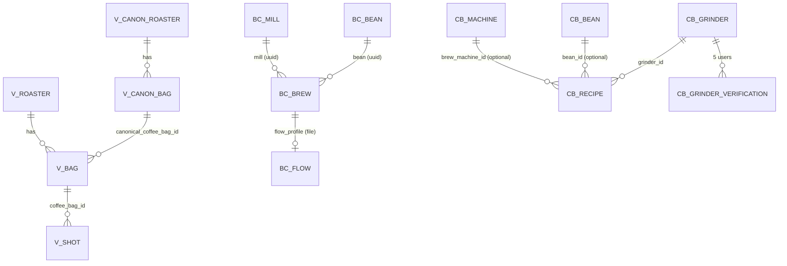
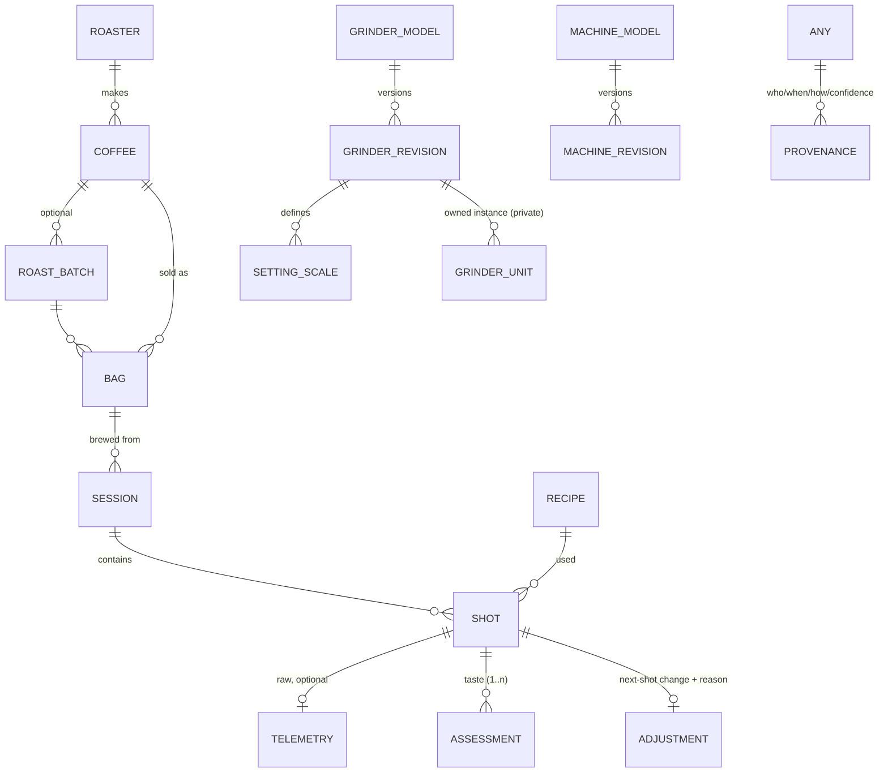

# Data-model analysis

Dated 2026-10-12. "Existing" fields below were read in the schemas/interfaces listed in `source-code-findings.md`. Everything under **Proposal** is a *design*, not an existing contract.

## 1. What each system actually models

| Concern | Beanconqueror | Visualizer | Caliburr | OBBW | This project (`COMMUNITY.md`) |
| --- | --- | --- | --- | --- | --- |
| Roaster / product identity | `Bean.roaster` + `Bean.name` (strings, per user) | `canonical_roasters`, `canonical_coffee_bags` (shared) + user `roasters`, `coffee_bags` | `beans(name, roaster, origin, process, roast_level)` shared, no bag | none | `coffees/<roaster>/<coffee>.json` (shared) |
| Bag / roast date | same record as bean (`roastingDate`, `openDate`, frozen*) | `coffee_bags.roast_date`, frozen/defrosted dates | `recipes.roast_date` only | none | `Bag` (roast date, opened date) 1:n |
| Roast batch / lot | no (free text in `bean_information[]`) | `canonical_coffee_bags.harvest_time`; no batch | no | none | not modelled |
| Grinder identity | `Mill.name` free text | `shots.grinder_model` string | **`grinders` entity**: brand, model, burr_type, adjustment_type, steps_per_unit, range_min/max, verified | none | registry `grinders/<brand>-<model>.json` (unit, `um_per_unit`) + per-owner burrs/zero date |
| Grind setting | `grind_size` string | `grinder_setting` string | `grind_setting` text ("never normalised") | none | `{value, unit}`; latent axis fit |
| Setting calibration | none | none | none (range only) | none | `um_per_unit` + fitted per-model scale, per-grinder offset |
| Recipe | on the brew | on the shot (+`profile_title`) | `recipes` (dose/yield/time/temp) | presets (target weight, guards) | Recipe (dose, yield/ratio, time, pre-infusion, offset) |
| Machine | `preparationDevice` / `method_of_preparation` | via `profile_title`, metadata | `brew_machines` (brand, model, type) | machine JSON profile | shared machine list (§8a-2) |
| Shot summary | `Brew` (times in s + ms) | `shots` (strings for weights) | recipe row | `ShotLogRecord` (deci-s, centigrams) | dial-in record, shot record |
| Telemetry | `BrewFlow` file, delta-coded in import API | `shots` file + `sha`; formats parsed per vendor | none | diagnostic scale profile only | optional shot record |
| Taste | `rating` (user-scale), `cupping`, `cupped_flavor` | `espresso_enjoyment` int, 8 SCA-like integer axes, notes, TDS/EY | `notes`, bean `tasting_notes[]` | `rating` | `taste`, `rating` |
| Provenance / review | none | `public`, premium gating, LLM `grind_suggestion` | `verified`, `*_edits`, `*_verifications`, `created_by`, soft-delete | n/a | signed records, PR review, `status/<key>.json` |
| Versioning | storage `VERSION`; export unversioned | API v1.18.1 | `recipe_history` snapshots, SQL migrations | `schemaVersion`, `apiVersion` | `v:1` per record |

### Findings that shape the canonical model
1. **No existing system has a grinder-setting calibration model.** Caliburr has an adjustment-type enum and a numeric range only; Beanconqueror and Visualizer store free strings. `grinder-converter` (MIT) has measured particle-size distributions per setting for 74 grinders — a *physical* model, not a *dial* model — and so is the only artefact that could seed "relationships between nominal settings and observed outcomes".
2. **Only Visualizer separates shared coffee identity from a user's bag** (canonical vs user records). Beanconqueror merges them; Caliburr omits bags. This project's `Coffee → Bag` split matches Visualizer's.
3. **Shot summaries cannot be reconstructed from each other.** Visualizer stores weights as strings; OBBW as centigrams/deciseconds; Beanconqueror as seconds + ms with water *in* (ml) mandatory. A summary → telemetry round trip is lossy in one direction only: telemetry → summary is derivable, summary → telemetry is not. **Raw telemetry must be retained wherever it exists.**
4. **Rating scales are not interchangeable**: Beanconqueror clamps incoming ratings to the *user's configured* scale and never rescales (documented); Visualizer uses an integer `espresso_enjoyment` (score shown as `/100` in its LLM prompt); OBBW has `rating` (range not read). Store raw value + scale descriptor, never only a normalised score.
5. **Time conventions differ**: OBBW durations in deciseconds and an explicit local-offset-at-completion; Beanconqueror `unix_timestamp` seconds + flow timestamps `HH:mm:ss.SSS`; Visualizer `start_time` datetime without precision. A canonical record needs UTC instant + monotonic offsets (ms) per sample.

## 2. Proposed canonical model (design)

Principle: **identity records are shared and reviewed; observations are immutable and reference identities by id + revision.** Shared records are append-only versions; a shot stores `grinder_revision_id`, so a later correction cannot silently change history (this directly addresses §2.4 of the brief).

### Entities and fields
Only fields I can justify from an existing schema or from this project's physical needs; "Source" cites where a precedent exists.

| Entity | Key / id | Fields (type, unit) | Source / precedent | Required |
| --- | --- | --- | --- | --- |
| `roaster` | slug + UUIDv7 | name, country, website | Visualizer canonical_roasters | name |
| `coffee` (product) | slug under roaster | name, origin(s) {country, region, producer, farm, elevation_m, variety, process}[], blend_flag, roast_level (enum + free text), tasting_notes[] | Visualizer canonical bags; Beanconqueror `bean_information[]`; COMMUNITY.md | roaster, name |
| `roast_batch` (optional) | id | roast_date, lot/crop year, roast_level_measure {scale, value} | none exists (gap) | roast_date |
| `bag` | UUIDv7 (private by default) | coffee_ref, batch_ref?, roast_date, open_date, frozen/defrosted dates, weight_g | Visualizer `coffee_bags`; Beanconqueror frozen* | coffee_ref, roast_date? |
| `grinder_model` | slug | manufacturer, model, adjustment_mechanism enum {stepped, micro_stepped, stepless, other}, burr_type | Caliburr enums | manufacturer, model |
| `grinder_revision` | model + revision id | burr_set, release_year, source_docs[], status {draft, approved, superseded} | none (gap) | |
| `setting_scale` | per revision | unit label (e.g. "click", "number", "um", "turns"), direction {higher_is_coarser, higher_is_finer}, min, max, step, sub_steps, reference_points[] {setting, meaning, how_measured}, `um_per_unit?` (only if manufacturer-published), representation notes (multi-dial grinders: array of components) | Caliburr range/steps; COMMUNITY.md `um_per_unit` | unit, direction |
| `grinder_unit` | UUID (private) | model_revision_ref, burr age/zero setting, calibration offset | COMMUNITY.md ("zeroed") | |
| `machine_revision` | slug | manufacturer, model, revision, control profile ref (OBBW-style `interface.control`), pre-infusion capability, basket options | OBBW machine JSON; COMMUNITY.md §8a-2 | |
| `recipe` | UUIDv7 | dose_g, target_yield_g or ratio, target_time_s?, pre-infusion {mode, duration_s}?, temperature_c?, stop offset g | Beanconqueror doseIn/beverageOut; OBBW presets | dose, yield |
| `shot` | UUIDv7 | started_at (UTC), recipe snapshot, bag_ref, grinder_revision_ref + setting {value, scale_ref, **raw_text**}, machine_revision_ref, basket_ref?, scale_ref, outcome {yield_g, total_time_s, first_drop_s?, pre-infusion_s?, stop_command_t_s?, final_weight_g, post_stop_drip_g?, stop_reason}, flags {prep_issue?, channeling?} | Beanconqueror, Visualizer, OBBW log | started_at, setting.raw_text |
| `telemetry` | content hash | series: t_ms[], weight_g[], (pressure/flow/temp where present), events[] {t_ms, type}; sample source + clock info | Beanconqueror `flow`; Visualizer parsers | optional |
| `assessment` | UUIDv7 | rater (private id), rating {raw, scale_min, scale_max, scale_label}, sensory[] {attribute, value, scale}, notes, confidence? | Visualizer 8 axes; Beanconqueror rating | raw |
| `adjustment` | UUIDv7 | from_shot, to_shot, setting delta in `scale_ref` units, reason enum {too_fast, too_slow, sour, bitter, preparation, other}, user_confirmed | none (gap — needed for §2.6) | |
| `provenance` | per record/version | submitted_by (pseudonymous key id), submitted_at, source {user, import:<system>, manufacturer_doc}, license_of_origin, review {status, reviewer, decided_at, note}, supersedes | Caliburr verification/edits; COMMUNITY.md signed records | |

### Field-level mapping to existing schemas
`→` = mapping exists and is lossless; `~` = lossy/needs convention; `✗` = target cannot hold it; `—` = no source.

| Canonical | Beanconqueror | Visualizer | Caliburr | OBBW | This project (dial-in rec.) |
| --- | --- | --- | --- | --- | --- |
| shot.outcome.yield_g | `brew_beverage_quantity` (type GR) → | `drink_weight` (string) ~ | `yield_g` → | `weightG` / `actualWeightCg`/100 → | `recipe.yield_g` → |
| shot.dose | `grind_weight` ~ (misnamed; 0 if missing) | `bean_weight` (string) ~ | `dose_g` → | none ✗ | `recipe.dose_g` → |
| shot.total_time_s | `brew_time` + `_milliseconds` → | `duration` → | `brew_time_s` → | `durationMs` / `durationDs`/10 → | `result.time_s` + `basis` → |
| shot.first_drop_s | `coffee_first_drip_time(+ms)` → | metadata only ~ | ✗ | `firstDropMs` / `firstDropDs` → | `first_drop_s` → |
| pre-infusion | `coffee_blooming_time` ~ (semantics differ) | profile-dependent ~ | ✗ | not in log (preset/machine state) ✗ | `recipe.preinfusion` ~ |
| setting.raw_text | `grind_size` → | `grinder_setting` → | `grind_setting` → | — | `grind.value` + unit ~ |
| grinder identity | `mill` uuid → `Mill.name` ~ | `grinder_model` ~ | `grinder_id` → | — | `grinder.model` → |
| bag.roast_date | `Bean.roastingDate` (via bean) ~ | `coffee_bags.roast_date` / `shots.roast_date` (string) ~ | `roast_date` → | — | `roast_date` → |
| coffee identity | `Bean.name/roaster` ~ | canonical ids → | `beans` → | — | `coffee` slug → |
| temperature_c | `brew_temperature` (0 if missing) ~ | metadata ~ | `water_temp_c` → | — | — |
| assessment.rating | `rating` (user scale) ~ | `espresso_enjoyment` ~ | — | `rating` ~ | `rating` ~ |
| sensory axes | `cupping`, `cupped_flavor` ~ | fragrance…bitterness ints → | `tasting_notes[]` (bean-level) ✗ | — | `taste` token ~ |
| telemetry | `BrewFlow` (weight, waterDispensed; per-sample) → | per-vendor file parse → | ✗ | diagnostic only ✗ | optional |
| provenance | `imported{source, sourceName, schema, params}` (only on import) ~ | `sha`, `public` ~ | `created_by`, verified ~ | — | signed envelope → |

**Known lossy transformations** (must be recorded in `provenance.import_loss[]`):
- → Beanconqueror: `waterIn` is mandatory in ml; for espresso it must be set (e.g. equal to yield) or the import fails validation; `ratio`, `app`, and `bean.imageUrl` are dropped; bean/grinder are matched by lowercase-NFC name and **the user is asked to create** missing ones; rating is clamped to the user's scale; no dedup → importing twice creates two brews.
- → Visualizer: numeric weights become strings; grinder = two free strings; roast_date is a string on the shot.
- ← Caliburr: setting is free text; no units; cannot be loaded without breaking its terms (Blocked).
- ← OBBW log: no time series; weights quantised to 0.01 g and times to 0.1 s.

### Units and time conventions (proposed)
Weights in grams (decimal, store raw sensor resolution); time in milliseconds relative to `shot.started_at` (UTC, ISO-8601 with `Z`) plus `clock_quality` {ntp, device_rtc, none}; temperatures in °C; flow in g/s derived, never stored as the only value; elevations in metres; ratings stored as `{raw, min, max}`.

### Identity and deduplication
- Shared records: human-readable slug (`roaster/coffee`) **plus** an immutable UUIDv7; aliases list for renames; merge = new version marking the loser `superseded_by`.
- Cross-reference external ids without depending on them: `external_ids: {visualizer_canonical_bag: uuid, loffee_labs: id, …}` (only recorded if the user's use of the source permits).
- Shot dedup key: `sha256(device_id | started_at | final_weight | duration)`; Visualizer matches on telemetry, Beanconqueror on `visualizerId`; both are *per-system* and must not be assumed equal.
- Grinders: dedupe on `(manufacturer, model, revision)`; physical equivalence (same burrs, different badge) as an explicit `equivalent_to` edge, never an implicit merge.

### Versioning and migration
- Every shared record file carries `schema: "<name>/<major.minor>"` and `rev: n`; additive changes bump minor; readers ignore unknown fields (mirrors the Beanconqueror envelope behaviour, which drops unknown top-level fields).
- Firmware only consumes the **built index** (as in `COMMUNITY.md` §5); the index carries `index_schema` so a future transactional backend can emit the same files — meets the "no firmware change on backend migration" requirement.
- Historical shots reference `grinder_revision_ref`; an approved correction creates revision N+1 and optionally a `reinterpretation` note, never an in-place edit.

### Confidence and provenance
Per-field confidence is *not* proposed (nobody captures it). Proposed instead: record-level `evidence_grade` {manufacturer_doc, measured_by_submitter, community_consensus (n≥k confirmations), unverified} and for fitted quantities store `n`, spread and method id (this project's index already publishes `kappa`, `flow_basis`, per-model `spread`).

### Missing information (cannot be assumed from any source read)
Roast batch/lot (no system holds it); basket geometry (none); grinder burr-wear/age; pre-infusion pressure; stop-command timestamp (only OBBW logs `targetReachedEarlyDs`/stop detail internally; not in public API); particle-size data linking dial settings to physical output beyond the 74 grinders in `grinder-converter`.

## 3. Comparison to the brief's required distinctions
- **Coffee identity:** stable = roaster, product name, origin(s), process, variety (changes rarely); batch-variable = harvest/crop, roast date, roast level measurement, tasting notes; bag-level = open/freeze dates. Visualizer's canonical/user split + a new optional `roast_batch` covers this; **no existing schema has batch**.
- **Grinder identity:** manufacturer → model → revision → burr set → unit; setting scales are attached to *revision*. Different representations are linked by **shared observations** (this project's per-model scale) never by asserted equivalence; `grinder-converter` buckets are an *optional prior*.
- **Shots:** sparse summaries suffice for dial-in direction; telemetry is required for flow normalisation (this project's §8d uses yield/time) and cross-machine comparison.
- **Comparability variables** (minimum for valid comparison): dose, yield, grinder revision + scale, bag age at brew, basket, machine revision, pre-infusion mode. Absent any of these the shot is stored but down-weighted in fits.
- **Subjective data:** keep `{raw, min, max}`; derive z-scores per rater only inside analytics.
