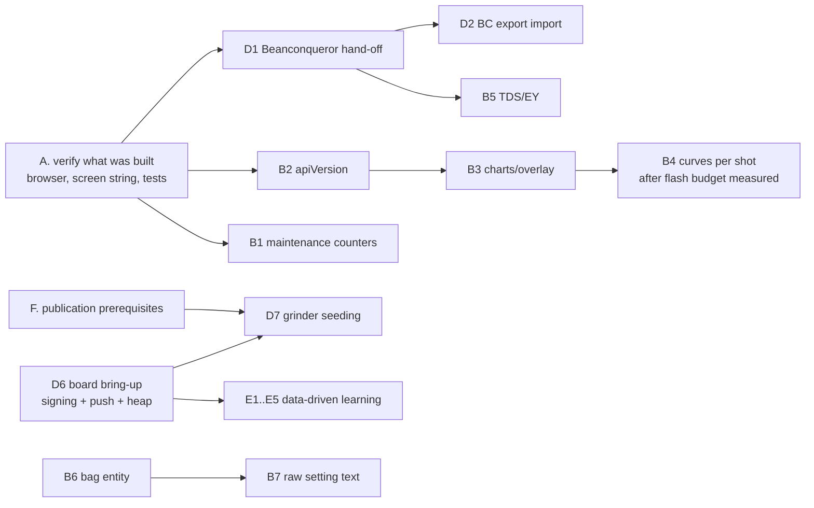

# Implementation plan: resolve gaps, reach feature parity, connect to existing offerings

Dated 2026-10-13. Based on `gap-analysis.md` (what others have), `roadmap-validation.md` (what `bdb-bbw` already had) and the three features built in this session. Effort numbers are **estimates** (person-days, one developer who knows the code), not measurements. Nothing here has run on a real board; the project's own status ("compiles; has not run on hardware") still applies to everything below.

## STATUS AFTER THE SECOND ROUND (13 Oct 2026, later) - read this first

This round did what the owner asked and then worked the packages below. **Corrections to section 0 and the packages that follow** (the original text is kept for the record):

* **Ratings now refine the time advice; they do not replace it.** The Grind-by-Sync-style verdict against the recipe's target time is computed first and stays the default; ratings act only when it says *keep*, only when the liked time is inside its tolerance, and move the grind by the base's own sensitivity towards it. See `docs/COMMUNITY.md` 8e. The 20% / 8 s constants are gone.
* **The research could not confirm the guesses** (`assumptions-validation.md`). The 3%-of-setting similar-coffee step has no source and is **removed**: the number now moves only when the owner's own coffees show it. The ratings thresholds have no source (two conventions remain: 4 stars, 3 shots). The freezer assumption of 0 was **contradicted**: it is now 0.10, bracketed by 0.03 to 0.33.
* **Package B4 is withdrawn**: the whole weight curve is already stored for every shot (about 2.6 kB for a 33 s shot at 10 Hz; 500 shots are about 2 MB of the 3.9 MB partition). My earlier statement that curves are kept only for recent shots was wrong; `docs/FEATURES.md` was stale.

| Package | Result |
| --- | --- |
| A1 look at the page | **done**: loaded in the browser pane against a throwaway emulator holding a copy of the real history; no console errors; Grinder (control chart, Ratings setting, grinder fields), Coffees (bags list, lookup and import card), Shots (dashed best-rated overlay, TDS box, Send button), Setup (upkeep) all rendered and worked |
| A2 aim shown on the controller | **done** (`liked: go finer: ...`) |
| A3 liked time in the shared dial-in | **not done**: a decision for the owner (settled still means the base verdict) |
| A4 settings grow at the end | **done** (host test of the load rule) |
| A5 ratings must not hide INCONSISTENT / NO_DATA | **done** (host test) |
| B1 upkeep counters | **done** (`core/Maintenance.h`, `/api/maintenance`, Setup card, status flag): host tests and end to end |
| B2 versioned API | **done** (`api_version`, `capabilities`, `docs/API.md`) |
| B3 control chart + reference overlay | **done** (page); seen in the browser |
| B4 curves per shot | **withdrawn** (already stored) |
| B5 TDS and extraction yield | **done** (store, API, CSV columns, page); host and end to end |
| B6 bag entity | **done**: `Bag`, library file v3, history v10 with a conversion from v9 (run on a copy of the real 54-shot history: every value identical, `.v9.bak` kept), per-bag advice, API, page |
| B7 non-numeric dials | **done**: divisors (halves ... hundredths) and two rings; format/parse round trip exact for all 2000 settings in every format, in C++ and in the page's JavaScript; shared records and the index keep them apart. **Not done:** letters |
| B8 scale-loss grace, B9 extraction guards | **deferred** as planned (hardware; conflict with the advisor) |
| D1 Beanconqueror hand-off | **done and verified against Beanconqueror's own decoder** with a real shot from the emulator's history; **not tried on a phone** |
| D2 Beanconqueror import | **done for coffees and bags** (not shots, by design); exercised in the page against the real firmware |
| D3 Visualizer via Beanconqueror | documentation only |
| D4 Visualizer canonical lookup | **done**; works from the page against the live API (CORS is open). Names are retailers' product titles |
| D5 Grindstep / Grindset imports | **blocked on sample files** from the owner's own accounts |
| D6 board bring-up (signing, push, heap) | **not possible without the board** |
| D7 grinder seeding | **curation**; not done |
| E1-E5 | **need contributors' data** |
| F1 contributor terms, safety statement, data terms | **drafts written** (`CONTRIBUTING.md`, `docs/SAFETY.md`, `docs/DATA-TERMS.md`), marked DRAFT for the owner and a lawyer |
| F2-F4 | **owner actions**: `github keys.txt`, public vs private, counsel |

Tests at the end of this round: host suite **3,829 checks, 0 failed**; four library self-tests pass; `page_settings_check.mjs` 51 checks; `page_interop_check.mjs` 38 checks with the real decoder; emulator builds; emulator end-to-end checks for coffees/freezer, bags, dial formats, similar coffee, ratings through real shots, upkeep, TDS, CSV.
**Never run:** anything on the real board; a phone; the owner's own running emulators were not touched (their history was copied, read only, for the migration test).

## 0. What is done (this session)

| Item | Where | Evidence |
| --- | --- | --- |
| **Ratings-driven target**: advice aims for the median time of shots rated 4-5 stars (≥3, agreeing within 8 s, within 20% of the recipe's time), otherwise the recipe's; `Settings::grindRatedTarget`; taste note; rating a shot now refreshes the advice | `core/GrindAdvisor.h` (`ratedTarget`, `adviseGrindRated`, `grindTasteHint`), `main.cpp`, `net/Web.cpp`, `net/WebPage.h`; `COMMUNITY.md` 8e | host checks (100 new across the three features); **end to end in a throwaway emulator**: 3 shots rated 5 changed the advice from "go finer" (vs 32 s) to "keep" (aim 25.99 s); switching the setting off restored 32 s; 2 sour verdicts gave `taste_hint -1` |
| **Frozen-bean fix**: `Coffee::frozenDate/thawDate`, `effectiveAgeDays`, new-bag reset, `frozen_days` in shared records and in the index builder's age | `core/Types.h`, `Community.h`, `Library.h`, `Share.h`, `main.cpp`, `Web.cpp`, `WebPage.h`, `library-template/tools/{verify_record,build_index}.py`; `COMMUNITY.md` 8f | host checks incl. rebuilding a pre-change library file; Python self-tests (verify_record, build_index); emulator: age 60→30 with 30 frozen days, still-frozen age stops at 10 |
| **Similar bag**: owner's most similar coffee → ordinal shift → start suggestion, offline | `core/SimilarCoffee.h`, `main.cpp` (`similarStart`), `Web.cpp` (`/api/community.similar`), `WebPage.h`, `ui/Ui.cpp`; `COMMUNITY.md` 8g | host checks (direction per factor, cancellation, unit/step floors, recipe reach, tie-break); emulator: lighter+higher coffee suggested 240 ± 22 from a 250 neighbour, `verified:false` |
| Test totals | `test/host/test_main.cpp` | host suite **3,653 checks, 0 failed** (was 3,553); 4 library self-tests pass; emulator build compiles; your running emulators and `emu/data` were not touched |

Caveats that matter: (1) the *size* of the similar-coffee shift (3% of the setting per step) and every threshold in the ratings rule are **judgement, not measurement**; (2) the controller screen still shows the recipe's target time, not the rated one; (3) the web page changes were syntax-checked (`new Function`) and the data paths exercised through the API, but **no browser was used to look at the page**; (4) `FROZEN_AGING_FRACTION = 0` assumes the freezer stops ageing entirely.

## 1. Principles for the rest

1. **The Breville MANUAL-button / Lunar / SwitchBot path stays bit-identical.** Every item below sits in advice, storage, web or tooling, not in the stop logic. Existing guards (`testPusherLinkKeepsSwitchBot`, `testScaleLinkKeepsLunarData`, `testMachineProfiles`) must keep passing.
2. **Append-only data.** New fields go at the end of persisted structs (the library and settings loaders tolerate shorter records); new record fields are optional with range checks in `verify_record.py`.
3. **Judgement constants are labelled and replaced by measurement** where the library can measure them (as the ageing rate is).
4. **Adapters live outside the firmware** (web page, phone, PC, CI). The firmware's external contract stays: the library's `index/` files and its own signed records.
5. Anything that talks to a third party (Beanconqueror, Visualizer, GitHub) is tested against that party's own code or sample files, not against my reading of its docs.

## 2. Work packages

Priority = value to dial-in quality and adoption ÷ effort; risk noted where a package could hurt existing behaviour.

### A. Finish and harden what was just built (1–2 days)
| # | Task | Acceptance |
| --- | --- | --- |
| A1 | Look at the web page in a browser (emulator): Coffees form (frozen/thaw inputs, "New bag" clears them), Grinder page notes (`grate`), community panel with and without library, Settings "Aim for" | screenshots reviewed; no console errors; no layout break on the 536-wide phone view |
| A2 | Show the aim on the controller's result/home screen when `rated == APPLIED` (e.g. `aim 26.0 s (your ratings)`) | UI string fits; host/emulator build compiles; no change when off |
| A3 | Publish the rated time in the dial-in record? Decide: current dial-in publishes the achieved average (unchanged). Add `result.liked_time_s` only if the library will use it | decision recorded; if yes, `verify_record` range + `build_index` handling + tests |
| A4 | Persist-format guard test for `Settings` growth (older NVS blob) | host test loads a shorter settings blob; `grindRatedTarget` defaults true |
| A5 | Conflict check with `FEATURES.md` #7 rules: a rated target must not mask the **INCONSISTENT** state | covered by test; add one with a mixed run at a setting |

### B. Close the remaining gaps from `gap-analysis.md`
| # | Gap | Task | Files | Effort | Acceptance | Risk |
| --- | --- | --- | --- | --- | --- | --- |
| B1 | G6 Maintenance counters | shots since backflush / descale / burr clean, "done" buttons, Bot battery | `Types.h` (new persisted block), `Store`, `Web.cpp`, page | 1–2 d | counts survive restart; reminder intervals user-set; no effect on shots | low |
| B2 | G9 Versioned API | add `apiVersion`, `capabilities[]`, stable `deviceId` (random, not MAC) to `/api/status`; document in README | `Web.cpp`, `docs/` | 0.5 d | tests/fixtures parse; additive only | low |
| B3 | G5 Control chart + reference overlay | time-per-shot chart vs target ± tolerance with setting changes; overlay current shot on the best-rated one | page, `ShotData.h` | 3–5 d | works with curves present; falls back with a message when the best shot has none | page size (47 KB today) |
| B4 | G5 Downsampled curve per shot | store 2 Hz curve (~560 B) for every shot, full curve for recent | `Store`, `ShotData.h` | 2–3 d | flash budget measured (LittleFS free) before enabling; migration keeps old shots | **flash budget unmeasured**; do after A1 and a board measurement |
| B5 | G4 TDS → extraction yield | optional TDS per shot (typed), EY = TDS × yield / dose, shown and exported (CSV, Beanconqueror hand-off) | `Types.h` ShotRecord tail, `ShotFormat.h`, page | 1–2 d | CSV gains columns at the end; old CSV readers unaffected | low |
| B6 | Bag entity (data-model gap) | split bag (roast date, opened, frozen dates, weight) from `Coffee`; a "new bag" creates one; shots reference it | `Types.h`, `Library.h` migration, page | 4–6 d | old libraries migrate with identical advice; host tests for migration | **medium**: touches library format and the per-bag history filter; do after A and B1–B2 |
| B7 | Raw setting text (data-model gap) | keep an optional free-text setting beside the integer (e.g. "3.5", "B7") for dials the integer cannot represent | `Types.h` Preset/ShotRecord tails, record `grind_text` | 3–4 d | integer path unchanged; text shown in history and exports | medium; product decision first (Q20) |
| B8 | Scale-loss grace (G8) | short reconnect grace tied to recent shot durations, resume control on return | `BrewController.cpp` | 2–3 d + hardware | **only after** Lunar drop rates are measured on the board; defaults to current immediate stop | **safety-relevant**; keep behind a setting, off |
| B9 | Extraction guards (G7) | *defer*. If revived: flag guard-ended shots as censored and exclude from the µm/s fit | `BrewController.cpp`, `GrindAdvisor.h` | 4–6 d | n/a now | conflicts with the advisor; not planned |

### C. Feature parity (where others lead and users will notice)
| Area | Leader | Plan | Effort |
| --- | --- | --- | --- |
| Logbook depth: graphs, cupping, photos, TDS, Visualizer sync | Beanconqueror | **Do not build.** Hand shots to Beanconqueror (D1) and let it do the rest | covered by D1 |
| Accidental-bump / start window | OBBW | review `minShotTimeMs` (3 s) vs OBBW's 12 s protection window on the board; add a configurable window only if cup placement causes false stops | 1 d + hardware |
| Sensory axes | Visualizer/BC | defer | — |
| Home Assistant / webhooks | OBBW | after B2: a single `end`-event webhook (opt-in, plain `http://` like OBBW's) — only if users ask | 2 d |
| Starting suggestion for new coffee | Visualizer / Grindstep (claim) | **done (8g)**; next make it measured (E2) | — |
| Taste-aware advice | Visualizer / Act Four (claim) | **done (8e)** | — |

### D. Integration points
| # | Integration | Direction | Boundary / transport | Status of evidence | Tasks | Effort | Acceptance |
| --- | --- | --- | --- | --- | --- | --- | --- |
| D1 | **Beanconqueror hand-off** (`beanconqueror://ADD_BREW`) | out | web page builds gzip+base64url link, ≤400-char chunks | **Verified against Beanconqueror's real decoder** (research/validation/): accepts controller-shaped shot incl. 0.01 g flow deltas; rejects missing `waterIn`, fractional rating, numeric `grindSize`, no-zone date | button on Shots page: map `ShotRecord` + `/api/shot/data` → envelope (`waterIn`=yield, `grindSize` as text, rating integer, date from phone clock if `epochS==0`); remember sent ids (no upstream dedup); **test on a real phone** (CompressionStream + custom scheme from an http page is unverified) | 3–5 d | a shot appears in a real Beanconqueror with its trace; double-send documented |
| D2 | **Beanconqueror export import** (private history) | in | file picker on the web page; parse `BEANS/BREWS/MILL/PREPARATION`; brew→bean/mill via `config.uuid` | mapping **checked on one real upstream fixture** (research/validation/import-mapping-check.mjs); full-storage export untested | filter espresso only and sane ranges; coffees to the shelf; dial-ins as **private** history (never signed community records); idempotent by BC `config.uuid`; treat BC grind strings as unit-less hints until the grinder unit is confirmed; add fixture tests from upstream sample files | 4–6 d | importing the same file twice adds nothing; non-espresso skipped; ranges enforced |
| D3 | **Visualizer** | out (via D1), optional | Beanconqueror's own Visualizer upload; **not** a hand-built file (Visualizer's parser needs Beanconqueror's internal export shape) | corrected in roadmap-validation §5.2; unverified end to end | document the route; no firmware work | 0.5 d docs | — |
| D4 | **Visualizer canonical coffee lookup** | in | companion page calls `GET /api/canonical_coffee_bags?q=` (no auth), caches per user | endpoint verified in the OpenAPI; **data terms unknown**; 50 req/min per IP | autocomplete only; never mirror into the public catalog; respect the 23-char name limit | 1–2 d | optional, off by default |
| D5 | **Grindstep / Grindset imports** | in | their JSON/CSV exports | store claims only | obtain sample exports from the owner's own accounts; build adapters from samples | 1–2 d each, after samples | fixtures from real exports |
| D6 | **Library (GitHub) path on the board** | out/in | `LibraryLink.cpp` (compiles, unrun) | project's own docs; PC-side requests verified | first real signed record: mbedTLS signature verifies in `verify_record.py`; measure free heap with Wi-Fi + BLE + TLS | 2–5 d + board | one signed coffee and one dial-in accepted by Intake; heap floor recorded |
| D7 | **Grinder registry seeding** | in (data) | PRs to the library from manufacturer manuals; `grinder-converter` for model names only | provenance of its distributions unknown | extend `GRINDER_MODELS` (5 today) through reviewed grinder PRs with `um_per_unit` + source URL; no Caliburr data | curation | each grinder PR cites a manual |
| D8 | OBBW interop / HA | both | webhook / REST | OBBW's pusher is a relay; this project's is BLE | defer | — | — |

### E. Learning from data (needs contributors, not just code)
| # | Task | Why | Needs |
| --- | --- | --- | --- |
| E1 | Held-out evaluation of the cross-grinder fit against a per-model median baseline | project notes list this as unrun | real contributors' records, not the invented example library |
| E2 | Measure the similar-coffee factors (roast, process, altitude) the way the ageing rate is measured: pairs of coffees by one owner on one grinder; publish an effect only when n ≥ threshold; then replace `SIMILAR_STEP_FRACTION` and the half-steps | turns 8g from a rule of thumb into a measurement | owner pairs in dial-in records (already carry roast level, process, altitude) |
| E3 | Measure `FROZEN_AGING_FRACTION` from bags with `frozen_days` | 8f assumption | records with `frozen_days` and repeat dial-ins |
| E4 | Test whether rated aiming improves outcomes: A/B by owner choice (setting on/off) with later ratings as the outcome | 8e's thresholds are judgement | rated shots under both settings |
| E5 | Auto-promotion of grinder definitions on independent confirmation (Caliburr pattern: 5 distinct keys) with reviewer veto | reviewer load | contributor volume |

### F. Publication prerequisites (not code, but they block going public)
| # | Task | Notes |
| --- | --- | --- |
| F1 | Contributor terms (DCO/CLA), data licence and consent text for shared records, safety/non-appliance statement, hardware licence | none of these exist yet in `bdb-bbw`; both repos are private |
| F2 | Check `C:\tools\github keys.txt` for live tokens and rotate | never opened by this work |
| F3 | Decide public/private for `Community-Coffee`; branch protection is unavailable on a private free repo | `COMMUNITY.md` §9 |
| F4 | Counsel review of the items in `license-and-risk-register.md` | ⚖ |

## 3. Sequence

Rationale: A first (cheap, protects what exists). D1 next because it delivers the most visible parity for the least code and its contract is already verified. D6 is on the critical path for everything shared but needs hardware; do it as soon as the board is available, in parallel with D1/B-items. B6/B7 change persisted formats, so they come after the smaller tail-append features and need an explicit go-ahead.

## 4. Totals (estimates)

| Block | Days |
| --- | --- |
| A | 1–2 |
| B1, B2, B5 | 3–5 |
| B3, B4 | 5–8 |
| B6, B7 | 7–10 |
| D1, D2 | 7–11 |
| D4, D5 | 2–4 (+ samples) |
| D6 | 2–5 + board |
| Parity extras (window review, webhook) | 1–3 |
| **Software total** | **~28–48** |
| E, F | not code-bound: depend on contributors, hardware and owner decisions |

## 5. Risks and how the plan contains them

| Risk | Containment |
| --- | --- |
| Ratings steer the advice toward a mood | thresholds + bound + setting to turn off; A5 test; E4 evaluation |
| Similar-coffee guess is wrong | labelled unverified; wide range; below any library figure; first shot takes over; E2 |
| Library/settings format growth bricks old data | tail-append only; loader tolerance tested (library) and A4 (settings) |
| Page grows beyond comfortable size on the board | B3/B5 measured against current 47 KB before merge; page not gzipped today (noted in `COMMUNITY.md`) |
| Hand-off breaks when Beanconqueror changes `v:1` | keep the decoder harness (`research/validation/`) and re-run it per upstream release |
| Importing pollutes the fit | D2 stores private history only, `machine = unknown`, never as signed records |
| Board bring-up reveals memory limits | D6 measures heap first; B4/B3 are gated on that |

## 6. Open decisions for the owner
1. Default for "Aim for": on (as built) or off until E4 data exists.
2. Whether published dial-ins should carry the liked time (A3).
3. Whether to support non-numeric dial settings (B7) and a Bag entity (B6) now or after the board runs.
4. Public vs private repositories, licences and consent text (F).
5. Whether to contact Visualizer / Beanconqueror maintainers (nothing was sent).
