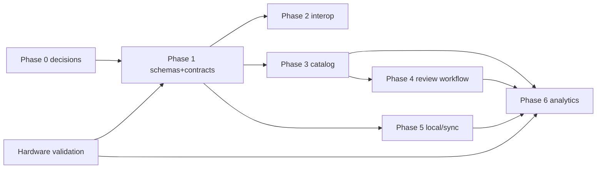

# Implementation roadmap

> **Superseded in part — read `roadmap-validation.md` §3 first.** This plan was written without having read `bdb-bbw`'s source. The review found Phases 1, 4, 5 and 6 largely **already built** (driver contracts, signed records, GitHub intake/review, outbox, fit), tested by 3,553 host checks (reproduced) and four library self-tests (reproduced). The real critical path is: board bring-up of signing + GitHub push → publication package (licenses, contributor/data terms, safety text, repo visibility) → hardware latency measurements → JSON Schema/versioning → Beanconqueror hand-off. Phase text below is kept for its acceptance criteria.

Dated 2026-10-12. Effort numbers are **estimates** (person-days for one experienced developer), not measurements. Facts about the current repo come from `docs/COMMUNITY.md` and project notes; "done" means the project's own documentation says so — not independently re-run here.

## Phase 0 — Decisions before publishing (1–3 d)
- Choose licenses per `license-and-risk-register.md` §2; add contributor terms (DCO or CLA) and a safety/non-appliance statement (model: OBBW `PROJECT_CHARTER.md`).
- Check `C:\tools\github keys.txt` and rotate if it holds live tokens (owner action).
- Acceptance: LICENSE files per component; CONTRIBUTING with data-license grant; README safety section.

## Phase 1 — Schemas and adapter contracts (5–10 d)
1. Write JSON Schemas for `coffee, bag, grinder_model/revision/setting_scale, machine_revision, recipe, shot, assessment, provenance` (`data-model-analysis.md` §2); add `schema` + `rev` + `index_schema`.
2. Migrate existing `dialins/` and `grinders/` records with a converter (no firmware change: firmware reads `index/` only).
3. Define `Scale`, `Actuator`, `MachineProfile` interfaces (ADR-001..003) and conformance tests using recorded BLE traces.
- Depends on: Phase 0.
- Acceptance: CI validates all sample records; existing records convert with zero data loss on a golden set; emulator + host tests still pass (project reports 3,553 checks).

## Phase 2 — Interop with existing apps (5–8 d)
1. Companion page emits Beanconqueror `ADD_BREW` links (I1); add idempotency log; test on iOS and Android.
2. Visualizer upload adapter via the user's own OAuth app (I2) — only after verifying format detection with a hand-built file; consider an upstream parser PR once `bbw-shot/1` is frozen (**owner decision; no contact made**).
3. Optional Visualizer canonical lookup for coffee autocomplete (I3) with a per-user cache.
- Depends on: Phase 1 shot schema.
- Acceptance: a recorded shot appears correctly in a real Beanconqueror install and a Visualizer test account; double-send behaviour documented.

## Phase 3 — Minimum public reference catalog (5–10 d + curation)
- Seed `grinders/` from manufacturer manuals (range, step, direction, unit); seed machines/scales from this project's own verified devices; seed coffees from *contributors*, not scrapes.
- Add PR templates and review checklists (already described in `COMMUNITY.md` "Reviewing a coffee/grinder").
- Optionally evaluate `grinder-converter` as prior (after provenance answer).
- Acceptance: ≥ N reviewed grinders (N chosen by owner), each with source reference; index builds in CI; a controller (emulator) consumes it.

## Phase 4 — Validation and review workflow (5–8 d)
- Intake checks for unit/range plausibility; duplicate detection by alias; revision workflow for corrections; reviewer guide; abuse handling (ban key id).
- Acceptance: correcting a grinder creates revision N+1 and an old shot still renders with its original scale; test fixtures cover it.

## Phase 5 — Local and synchronised storage (5–10 d)
- On-device: bounded ring of shots/dial-ins, export to JSON file via the AP web UI.
- Optional sync: personal contributor repo with a fine-grained token; relay later.
- Acceptance: device offline for a week then sync without duplicates; token never returned by any API (design rule in `COMMUNITY.md` §5).

## Phase 6 — Analytics and cross-user recommendation (open-ended; gated by data)
- Preconditions: enough settled dial-ins per model and coffee for hold-out evaluation (threshold to be set from Phase 3/4 data; **unknown now**).
- Experiments: (1) hold-out prediction error vs per-model median baseline; (2) KAPPA estimation once owners vary flow; (3) roast-level prior from real library data; (4) add machine to the fit.
- Acceptance: published methodology with n, spread, and failure cases; recommendations hidden below minimum-n.

## Parallel track — Hardware validation (owner, needs the machine)
Lunar sample jitter; Bot press-to-flow latency; toggle-state recovery; BLE-loss behaviour; two Lunar hardware variants. Required before the hardware plans are labelled "tested".

## Dependency graph

