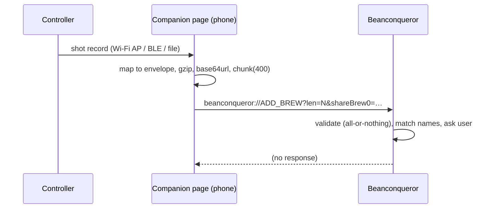

# Integration catalog

Dated 2026-10-12. Labels: **Verified** (read in authoritative source), **Documented but untested**, **Plausible**, **Unknown**, **Blocked**. No integration here was *executed*; "Verified" means the contract was read. Payloads quoted are copied from upstream docs/source; payloads marked *(design)* are proposals.

> **Review 2026-10-12 — corrections (details in `roadmap-validation.md` §4–5):**
> - **I1** now *Verified against Beanconqueror's real decoder* (harness: `research/validation/`); rules/results in `roadmap-validation.md` §5.1.
> - **I2** was misleading: Visualizer's Beanconqueror parser needs Beanconqueror's **internal export shape** (`brew.config.unix_timestamp`, `mill.name`, `brewFlow.*[].timestamp` "HH:MM:SS.mmm"), not the `ADD_BREW` envelope. Now **Defer**; preferred route is via Beanconqueror's own upload (inferred, unverified).
> - **I7** wrongly said hold/release is not a native primitive. Vendor `bot.md` defines `0x3` push-stop and `0x4` back; the project already implements PRESS/DOWN/UP (`PusherDriver.h`, `SwitchBotProtocol.h`).
> - **I6** (OBBW webhook interop) is **Defer**: this project's pusher is BLE, not a relay.
> - The "adapter contract" and driver notes below describe interfaces that **already exist** in `bdb-bbw/src/core/`.

## Summary matrix

| # | Integration | Direction | Transport | Status | Disposition | Effort (est.) |
| --- | --- | --- | --- | --- | --- | --- |
| I1 | Beanconqueror `ADD_BREW` hand-off | us → BC | deep link (custom URL scheme) | **Verified** contract | Integrate | S–M |
| I2 | Visualizer upload (`POST /shots/upload`) | us → Viz | HTTPS REST, OAuth2 | **Verified** contract | Integrate | M |
| I3 | Visualizer canonical coffee lookup | Viz → us | HTTPS GET, no auth | **Verified** endpoint; data terms **Unknown** | Integrate (lookup only) / Defer (bulk) | S |
| I4 | Beanconqueror full-export import | BC → us | JSON file | Plausible (format not read in detail) | Support as legacy | M |
| I5 | OBBW scale protocol table | OBBW → us | source reuse | **Verified** (already vendored) | Adopt | done |
| I6 | OBBW integration/webhook API | OBBW device ↔ HA/others | HTTP LAN | **Verified** | Integrate (interop, not dependency) | S |
| I7 | SwitchBot Bot BLE | us → Bot | BLE GATT | **Verified** spec; physical effect unconfirmed | Adopt spec | done/in-repo |
| I8 | Acaia Lunar BLE | scale → us | BLE | **Verified** (`docs/RESEARCH.md` §1) not on hardware | Adopt | done |
| I9 | Caliburr data | → us | — | **Blocked** | Reject / Compete | — |
| I10 | Gaggiuino / GaggiMate shot files | their export → us | JSON files | Plausible (formats visible only via Visualizer parsers; code is non-commercial-licensed) | Support as legacy (user files only) | M |
| I11 | Grindstep / Grindset import | → us | JSON/CSV | **Documented but untested** (store page), no sample | Defer until a sample file is obtained | S |
| I12 | grinder-converter distributions | → us | MIT data module | Verified files; provenance **Unknown** | Integrate as optional prior; Defer redistribution | S |
| I13 | Home Assistant (own integration) | us ↔ HA | HTTP/MQTT *(design)* | Plausible (pattern verified in OBBW) | Defer | M |
| I14 | Meticulous | ↔ | local HTTP/socket.io | **Unknown** (no first-party docs) | Defer | — |

---

## I1 — Beanconqueror `ADD_BREW`
- **Capability:** push a finished shot (summary + optional telemetry) into a user's local logbook.
- **Evidence:** `docs/brew-import-api.md`; decoder `src/services/intentHandler/brew-handoff.decoder.ts`; mapper `src/services/brewImport/brew-import.service.ts` @ `bbf8de0`. **Verified (read)**, not run.
- **Boundary:** the phone, not the ESP32. The controller cannot open a URL scheme; the *companion web page / phone app* must build the link. Constraint set by the contract: gzip + base64url JSON, ≤400-char query chunks, ≤512 KiB inflated, foreground app, onboarding complete, user prompted before bean/grinder creation, no dedup, no returned id.
- **Flow:**

- **Mapping (design from documented envelope):** `brew.date`←`started_at`; `brew.doseIn{g}`←dose; `brew.waterIn{ml}`←**yield (required field; espresso convention to be chosen)**; `brew.beverageOut{g}`←final weight; `brew.brewTime`←seconds; `brew.firstDripTime`←first drop; `brew.grindSize`←raw setting text; `brew.grinderName`←grinder label; `brew.preparationMethod`←"Espresso"/machine; `brew.rating`←raw (clamped, **not** rescaled); `bean{name, roaster, roastingDate…}`; `flow{fidelity, t[] delta ms, weight[] delta decigrams}`; `imported{source:"bbw-controller", sourceName, schema:1}`.
- **Example payload:** the upstream doc's batch example is the only verified payload (see `docs/brew-import-api.md`, "Batch"); a controller-specific example would be a *(design)*.
- **Failure modes:** link truncation (handled by chunking); user not onboarded → silent no-op; duplicate imports (no dedup): the sender should remember sent `shot.id`; schema bump upstream (`v` must equal 1 — a hard break).
- **Alternative if it fails:** emit the same data as a Visualizer-compatible JSON or a Beanconqueror-export-compatible file for manual import.
- **Licensing/privacy:** talking to the app over its documented intent does not combine code; GPL-3 does not reach us. Data stays on the user's phone.
- **Open questions:** does the deep link work from Android Chrome/Safari as well as from our own web UI served over the controller AP? (not tested); behaviour when `brew.waterIn` = yield for espresso (display semantic).

## I2 — Visualizer upload
- **Evidence:** `openapi.yaml` v1.18.1 @ `0627baa`: `POST /shots/upload` multipart `file` or raw JSON body; format auto-detected; OAuth2 `upload` scope; rate limits 50/min per IP, 200/10 min; free tier 30 shots per rolling 24 h; response `ShotUploadResult`. **Verified (read)**.
- **Reality check on formats:** detection rules key off *other apps'* JSON shapes (`mill`/`brewFlow` → Beanconqueror; `datapoints` → Gaggiuino; `samples` → GaggiMate; `profile_name`+`data` → Meticulous). There is **no "generic summary" format**; to upload from this project we must either emit one of those shapes (fragile — it is upstream's parser behaviour, not a published schema) or **contribute a parser upstream** (MIT, a Ruby model in `app/models/parsers/`). 
- **Boundary:** user's own OAuth app registration + token held on the phone/PC, **never in firmware** (tokens expire weekly; refresh flow).
- **Disposition:** Integrate optionally; **Contribute upstream** a parser for a documented `bbw-shot/1` format *only after* that format is stable (not done; no contact made).
- **Failure modes:** 422 on daily limit; 403 if email unconfirmed; 429; parser drift; service outage.
- **Alternative:** Beanconqueror export route (I1) or local files.

## I3 — Visualizer canonical lookup
- `GET /api/canonical_roasters?q=…`, `GET /api/canonical_coffee_bags?q=…&…` (no auth; words <3 chars ignored for bags; paged with `page`,`items`). **Verified (spec)**. Use: autocomplete + `external_ids.visualizer_canonical_bag` for dedup.
- **Constraint:** the data's upstream licence (Loffee Labs) is Unknown; do not mirror into the public catalog; cache per user only. 50 req/min/IP is easily exceeded if controllers call directly → call from a companion app/relay with caching, not from firmware.

## I5/I8 — Scale drivers (OBBW table, Acaia)
- **Evidence:** `ScaleProtocol` struct (see findings §1.1); this project's `lib/EspressoScaleProtocol` contains unmodified OBBW files; protocol table verified in `docs/RESEARCH.md` §1 against 3 independent decoders. **Hardware verification pending** (notes say "Not verified on hardware").
- **Contract gap vs. proposed abstraction:** add (a) per-instance capability discovery, (b) sample timestamp source & jitter metadata, (c) stability flag, (d) battery (where the protocol has it). Keep OBBW struct as the *wire* layer and wrap it in a thin `Scale` interface owned by this project (the project's "scale abstraction" refactor — backup folder `bdb-bbw-backup-2026-10-11-before-scale-abstraction` suggests this is underway).
- **Contribute upstream** candidates: protocol fixes found on real Lunar variants (the README flags USB-C Lunar as "Hit or Miss").

## I7 — SwitchBot Bot BLE
- **Evidence:** `OpenWonderLabs/SwitchBotAPI-BLE/devicetypes/bot.md` (read): payload `0x57 0x01 <act>` executes an action (press), `0x57 0x0f 0x08 <seconds>` sets long-press duration, reply `0x01` = "action executed" (acknowledgement of the command, **not** proof that the physical button moved); modes (press / switch, inverse) in settings; the third-party `switchbotpy` description mentions password-protected bots; that was **not** traced in the vendor doc. **Verified (doc)**, **unverified on this machine**.
- **Core contract implied:** `press(duration?)`, `hold(ms)` via *configured* long-press; `release` is not a separate BLE command in this doc → **hold with arbitrary duration is not a native primitive**; model it as `pulse(ms)` with device-defined resolution.
- **Failure handling:** command delivery ack only; machine-state confirmation requires another signal (scale weight rising, machine LED/reed sensor). Safe behaviour on BLE loss: nothing to abort if a pulse was already delivered; if the machine is toggle-type and a *start* was delivered but *stop* cannot be, the controller must alert (cannot stop remotely).

## I6 — OBBW interop (webhook/HA)
- Verified contract (`docs/INTEGRATION_API.md`, `docs/features/webhooks.md`). Our controller can *emit* an OBBW-shaped `end` webhook so existing HA integrations work; or consume OBBW webhooks if a user runs both. The payload quoted in `source-code-findings.md` §1.5 is the verified shape. This is **interoperability**, not reuse.
- Unauthenticated LAN API by design → do not copy the pattern for any write path without auth (risk R-sec-1).

## I9 — Caliburr (Blocked)
No API, no export, bot use forbidden, license to "other users of the service" only. Alternatives: (a) own governance + registry (this project), (b) manufacturer manuals for grinder scales, (c) *ask the operator* whether a data-sharing licence is possible (action for the owner, not done here).

## I10/I11 — Gaggiuino/GaggiMate and Grindstep/Grindset
- Gaggiuino (CC BY-NC) and GaggiMate (CC BY-NC-SA): do not incorporate their code or schemas into a repo intended to allow commercial use of the hardware plans/firmware; reading a **user's own exported file** is data interchange and does not require copying their code, but **ask counsel** about schema-as-expression. Shot files can also reach us indirectly via Visualizer export (`GET /shots/{id}/download`, **Documented**, untested).
- Grindstep: page claims JSON + CSV export; no sample inspected → cannot define a mapping. Grindset: "export full shot history" claim; web only. Action: obtain sample exports from one's own accounts (owner action) before any adapter design.

## I12 — grinder-converter
- MIT module per grinder (`src/grinders/*.ts`, 74 files): `settings[] {label, step, subStep, sampleMassGrams, distributionGrams{>900, 900-600, 600-300, <300}, measured, qualityFlag?}`. Use as an **offline prior** when a grinder model has no fitted scale: compute a latent "fineness" index from the distribution (design; the mapping from distribution to a dial-in axis is a research problem, not verified).
- Do **not** assume bucket mass ↔ extraction rate; fines fraction affects flow non-linearly (the project's own decision: flow is the observation, not the axis).

## Proposed adapter contract (design)
```
interface ShotSink      { id; capabilities; send(shot, telemetry?) -> {delivered, remote_id?, warnings[]} }
interface ShotSource    { id; list(since); fetch(id) -> {shot, telemetry?, import_loss[]} }
interface RegistryFeed  { id; license; search(q) -> [{canonical_id, fields, source_ref}] }   // lookup only unless license allows mirror
```
Adapters run on the phone/PC/CI, never in firmware; the firmware's only external contract is the built `index/` plus its own signed submission envelope.

## Validation steps (all outstanding)
1. Send one `ADD_BREW` link from a phone to a Beanconqueror install; confirm import, rating clamp, no dedup, flow trace renders.
2. Upload one hand-built Beanconqueror-shaped JSON to a Visualizer test account; confirm detection and re-upload idempotence.
3. Capture a Lunar trace and a Bot actuation on the real Breville; measure press-to-flow latency distribution.
4. Obtain one real Grindstep export and one Grindset export from the owner's own accounts.
5. Ask Visualizer's maintainer (contact in OpenAPI `info.contact`) and Loffee Labs for data-terms clarification — **owner action; nothing was sent.**
